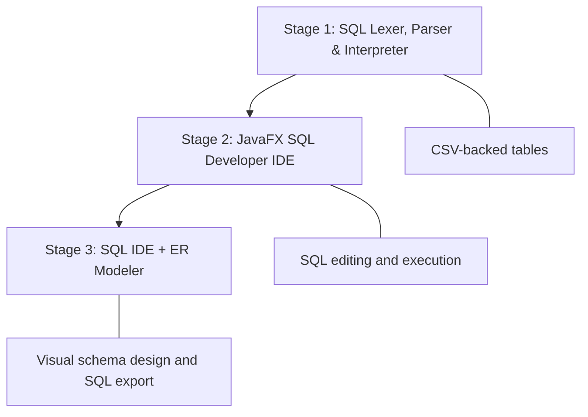
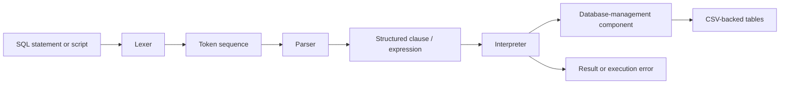
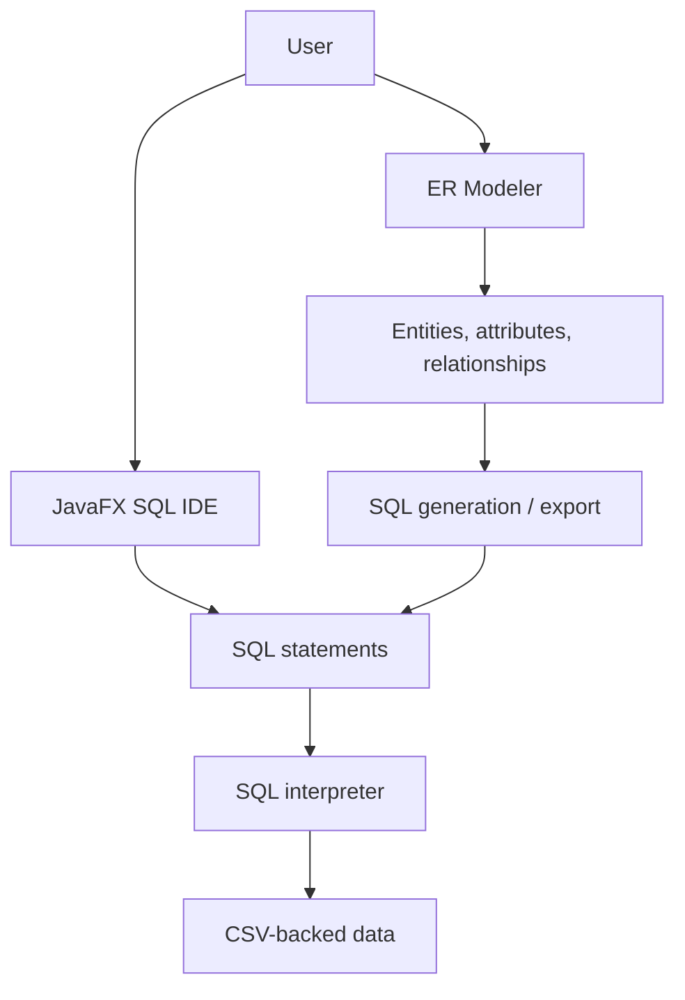

To understand interpreters I really recommend reading the book [Crafting Interpreters](https://craftinginterpreters.com/) by Bob Nystrom. It is a great book but if you only read it you will not really have a good understanding of how interpreters work, you need to implement one yourself. This project evolved from a hand-built SQL lexer, parser, and interpreter into a desktop SQL development environment, and later into an IDE with visual entity-relationship (ER) modeling and SQL generation.

The project was developed across three dependent repositories. I built the SQL interpreter and the initial SQL IDE independently; the final stage, which extended the IDE with a database modeler; was a collaborative project with two other contributors lead by me.

## Project Repositories

| Component | Repository | Contribution |
|---|---|---|
| 1. SQL Interpreter | [sql_parser](https://github.com/ricardouriegas/sql_parser) | Individual project — designed and implemented independently |
| 2. SQL Developer IDE | [sql_developer](https://github.com/ricardouriegas/sql_developer) | Individual project — designed and implemented independently |
| 3. SQL Developer & Modeler | [sql-developer-and-modeler](https://github.com/ricardouriegas/sql-developer-and-modeler) | Team project — developed with two other contributors |

### At a Glance

- **Language:** Java
- **Desktop UI:** JavaFX
- **SQL editor component:** RichTextFX
- **Build tooling:** Maven is used by the desktop application repositories
- **Storage model:** CSV-backed tables rather than a connection to a commercial database server
- **Core concepts:** Lexical analysis, parsing, grammar design, interpretation, query execution, data validation, desktop UI development, ER modeling, and SQL generation
- **Language-design reference:** [Crafting Interpreters](https://craftinginterpreters.com/)

> **Scope note:** This is a custom SQL implementation intended to explore language-processing concepts and database tooling. It should not be presented as a complete implementation of the SQL standard or as a replacement for a production database engine.

---

## 1. Project Evolution

The project grew in three stages, with each stage adding a higher-level way to work with the underlying database functionality.



### Stage 1 — Build the SQL Interpreter

I started by building the language-processing layer myself: defining a SQL vocabulary and grammar, tokenizing input, parsing the token sequence into structured clauses, and interpreting those clauses to execute operations against CSV-backed tables.

**Repository:** [ricardouriegas/sql_parser](https://github.com/ricardouriegas/sql_parser)

### Stage 2 — Build a Desktop SQL IDE

I then built a desktop interface around the database functionality. The JavaFX application provides a SQL code area that can highlight code and execute the user's selected text, making it easier to work with queries than through a command-line loop alone.

**Repository:** [ricardouriegas/sql_developer](https://github.com/ricardouriegas/sql_developer)

### Stage 3 — Add Visual Database Modeling

In the final stage, the SQL developer application was extended with an ER modeler. The aim was to allow users to represent tables and their relationships visually and generate SQL from a diagram. This stage was completed collaboratively with two additional contributors.

**Repository:** [ricardouriegas/sql-developer-and-modeler](https://github.com/ricardouriegas/sql-developer-and-modeler)

---

## 2. Architecture Overview

The main architectural idea is to separate SQL processing into distinct responsibilities rather than trying to execute a query through string manipulation alone.



The desktop IDE provides a graphical entry point for SQL text and execution. The modeler adds a second workflow in which a user creates a database schema visually and exports SQL statements from that representation.



These diagrams show the intended conceptual flow of the three components, not a claim that the application implements every feature of a production database system.

---

## 3. Component One: SQL Lexer, Parser, and Interpreter

**Repository:** [sql_parser](https://github.com/ricardouriegas/sql_parser)

**Ownership:** Individual project — I built this component independently.

### Objective

Build a small SQL-processing system that accepts SQL commands and executes the supported operations against tables represented by CSV data. Instead of relying on a third-party SQL parser or delegating query execution to a database server, I implemented the main language-processing stages in Java.

I used the ideas and learning progression in [Crafting Interpreters](https://craftinginterpreters.com/) as a reference for designing the lexer, parser, and interpreter. I then adapted those concepts to a custom SQL vocabulary and the operations needed by this project.

### 3.1 Lexical Analysis

The lexer takes SQL source text and converts it into a sequence of tokens that the parser can understand. This creates a clear boundary between the characters typed by the user and the syntactic structure of a statement.

The custom vocabulary is defined around the project's SQL grammar, including statement keywords, identifiers, literals, operators, and punctuation. The lexer also detects invalid tokens and reports an error rather than silently treating invalid input as a valid statement.

**Why this matters:** Tokenization isolates character-level concerns from syntax rules. It makes the parser easier to reason about and makes errors easier to locate within the processing pipeline.

### 3.2 Grammar and Parsing

I designed a grammar for the SQL subset used by the application. The parser consumes the token list generated by the lexer and converts it into structured clauses that describe a command's meaning, including information such as statement type, table, columns, and filtering expression.

The grammar file documents rules for statements and expressions, including `SELECT`, `CREATE TABLE`, `DROP TABLE`, `INSERT`, `UPDATE`, and `DELETE`, as well as filtering, ordering, and limiting results. The expression grammar describes arithmetic operators, comparisons, logical `AND` / `OR`, and parenthesized expressions.

The checked-in examples also exercise table and column constraints such as:

- `PRIMARY KEY`
- `FOREIGN KEY` and `REFERENCES`
- `UNIQUE`
- `NOT NULL`
- `DEFAULT`
- `CHECK`

Example SQL scripts include operations such as `ALTER TABLE` and aggregate queries using functions such as `COUNT`, `SUM`, `AVG`, `MAX`, and `MIN`, along with `DISTINCT`. The exact supported subset is narrower than the full SQL standard, and the repository's grammar notes identify features such as `AS`, `GROUP BY`, and `IS` as unfinished or unsupported. The grammar and examples should therefore be read as documentation of an evolving, custom implementation rather than as a claim of full SQL compatibility.

### 3.3 Interpretation and Execution

After parsing, the interpreter receives a structured clause and executes the corresponding operation. This separates understanding a statement's syntax from performing its effect on the data.

The usage documentation describes the responsibilities of the main stages as follows:

1. The **lexer** scans the SQL text and returns tokens.
2. The **parser** consumes those tokens and returns a structured clause.
3. The **interpreter** receives the clause and executes the operation represented by it.
4. Errors raised during tokenization, parsing, or interpretation can be caught by the caller and presented to the user.

### 3.4 CSV-Backed Tables

The implementation uses CSV files as table storage rather than relying on an external database server. This kept the project focused on the mechanisms involved in processing queries and applying changes to table data.

The database-management component is responsible for the data-side operations used by the interpreter and is also referenced by the desktop application as a locally packaged library.

This design made the project useful for exploring how a query processor connects a language front end to data operations, while keeping the storage layer simpler than a full database management system.

### 3.5 Error Handling

The usage guide documents error handling at multiple stages. Invalid tokens can be reported by the lexer, invalid clauses by the parser, and invalid operations or clauses by the interpreter. Callers can catch these errors and print an explanatory message.

Separating errors by stage is useful because a malformed token sequence, a syntactically invalid statement, and a command that cannot be executed are different classes of problem.

### 3.6 Example Query Workflow

The following is an illustrative example based on the SQL syntax used in the repository's sample scripts:

```sql
CREATE TABLE example (
    id NUMBER PRIMARY KEY,
    name STRING,
    age NUMBER
);

INSERT INTO example (id, name, age)
VALUES (1, 'Richy', 20);

SELECT * FROM example WHERE age >= 18;

UPDATE example
SET age = 21
WHERE name = 'Richy';

DELETE FROM example
WHERE name = 'Richy';
```

The interpreter's workflow is conceptually:

```text
SQL text
   ↓
Lexer: SQL text → tokens
   ↓
Parser: tokens → structured clause
   ↓
Interpreter: clause → operation
   ↓
Database-management component → CSV-backed table data
```

### Technical Work Demonstrated

- Designing a domain-specific vocabulary and grammar
- Implementing lexical analysis and parsing from scratch
- Separating syntax processing from interpretation and data operations
- Building expression rules for arithmetic, comparisons, and logical conditions
- Handling invalid input across multiple processing stages
- Connecting a custom language front end with persistent, file-backed tabular data

---

## 4. Component Two: SQL Developer Desktop IDE

**Repository:** [sql_developer](https://github.com/ricardouriegas/sql_developer)

**Ownership:** Individual project — I built this component independently.

### Objective

Provide a graphical desktop environment for writing and executing SQL queries through the project's database-management functionality. This stage focused on the developer experience: making SQL commands easier to enter, inspect, select, and execute.

### 4.1 JavaFX User Interface

The application uses JavaFX to create a desktop GUI. Rather than requiring every command to be entered through a terminal prompt, users can work in a dedicated SQL code area.

### 4.2 SQL Code Area with RichTextFX

The repository identifies [RichTextFX](https://github.com/FXMisc/RichTextFX) as the library used for the code area. It provides text highlighting and lets the application access the text selected by the user, supporting the workflow of executing a selected SQL statement or fragment.

This kept the UI implementation relatively lightweight while adding a more practical editing experience.

### 4.3 Integration with the Database Component

The IDE repository references a locally packaged `database_manager` JAR created for the project, alongside the RichTextFX JAR. This reflects the separation between the graphical application and the database functionality it calls.

### Design Considerations

- **Separation of concerns:** The GUI handles editing and user interaction, while database operations are provided by the database-management component.
- **Focused dependencies:** The repository describes the UI as a minimalist, mostly JavaFX implementation, using RichTextFX for the specialized code-area functionality.
- **Query-oriented interaction:** Users can select the part of the SQL text they want to execute rather than treating the entire editor contents as one indivisible command.

### Technical Work Demonstrated

- Desktop application development with JavaFX
- Integrating a text-editing library into a desktop interface
- Connecting GUI interactions with a separately packaged Java component
- Designing a development workflow around SQL editing and execution

---

## 5. Component Three: SQL Developer and ER Modeler

**Repository:** [sql-developer-and-modeler](https://github.com/ricardouriegas/sql-developer-and-modeler)

**Ownership:** Team project — developed with two other contributors.

### Objective

Extend the SQL developer application with visual database modeling. In addition to editing SQL manually, the application aims to let users represent a database schema as an entity-relationship diagram and generate SQL from that model.

### 5.1 Visual Schema Modeling

The modeler introduces a visual workspace for defining the structure of a database. Its intended modeling concepts include:

- **Tables / entities:** Represent database tables in the diagram.
- **Attributes:** Define a table's columns and their properties.
- **Relationships:** Connect tables and represent how their records relate.
- **Relationship cardinality:** Represent relationship types such as one-to-one, one-to-many, many-to-one, and many-to-many.

The modeler's project notes describe table and relationship objects. A table tracks information such as its name, attributes, primary key, and relationships. A relationship records the source table, destination table, and relationship type. The notes also propose a hash-based lookup structure keyed by table name to access table and relationship metadata efficiently.

### 5.2 Connecting Relationships to Tables

The repository's TODO list marks the task of keeping relationship lines attached to tables when they are dragged as completed. It also marks storing relationships in table objects as completed. These are important details for an interactive diagram: a relationship needs to remain connected to its endpoints as a user rearranges the schema, and the relationship information must be represented in the underlying model rather than only in the drawing.

### 5.3 SQL Generation and Export

The modeler's documented goal is to generate SQL from the current ER diagram. The repository's TODO list marks the SQL export feature as completed. This provides a bridge between visual schema design and the SQL workflow: a model can be represented as a diagram and then exported as SQL statements for further use or editing.

### 5.4 Team Collaboration and My Contribution

Unlike the first two individual stages, this extension was developed with two other people. My design notes document an approach based on explicit table and relationship objects, including table attributes, primary keys, relationship endpoints, cardinality, and hash-based lookup by table name.

When presenting this stage, I describe it as a collaborative extension to the IDE rather than claiming sole ownership of the whole modeler. The earlier interpreter and IDE remain individually developed components.

### 5.5 Known Unfinished Area

The repository's TODO list leaves database-to-diagram reverse engineering (importing an existing database schema to generate an ERD) unchecked. It should therefore be described as a future improvement, not as a completed capability.

### Technical Work Demonstrated

- Entity-relationship modeling and schema representation
- Modeling table attributes and relationships as application objects
- Tracking relationship endpoints during diagram interaction
- Exporting a visual model to SQL
- Extending an existing desktop application collaboratively
- Translating a visual representation of data structures into a textual database definition

---

## 6. Technology Stack and Concepts

| Area | Technologies / Concepts | Where It Was Used |
|---|---|---|
| Programming language | Java | All three components |
| Language processing | Lexer, tokens, parser, grammar, interpreter | SQL interpreter |
| SQL query processing | Statement clauses, expressions, filtering, table operations | SQL interpreter |
| Data storage | CSV-backed tables | SQL interpreter / database-management component |
| Desktop development | JavaFX | SQL IDE and combined IDE/modeler |
| Rich text editing | RichTextFX | SQL editor code area |
| Build and dependency management | Maven and JAR dependencies | Desktop applications |
| Data modeling | Entities/tables, attributes, primary keys, relationships, cardinality | ER modeler |
| Code generation | ER model to SQL export | ER modeler |
| Collaboration | Shared extension of an existing codebase | IDE/modeler stage |

---

## 7. Key Engineering Decisions

### Implementing the Language Front End

Building the lexer and parser myself provided control over the vocabulary and grammar and made the internal processing of SQL statements explicit. It also meant that supported syntax had to be defined by the project rather than inherited from a mature third-party parser.

### Separating the Processing Stages

The lexer, parser, and interpreter perform distinct responsibilities. This makes the path from user input to data operations easier to understand and gives each stage a clear place to detect and report errors.

### Using CSV as the Data Layer

CSV-backed tables kept the project self-contained and made the relationship between SQL commands and stored tabular data easier to experiment with. The trade-off is that the project does not provide the breadth of storage, concurrency, transaction, or operational capabilities associated with a production DBMS.

### Building a GUI Around the Core Functionality

The JavaFX IDE created a more accessible way to enter and execute SQL. The modeler extended this idea by supporting a visual representation of the schema and the generation of SQL from that representation.

### Representing Schema Relationships Explicitly

The modeler's design notes describe relationships as first-class objects with source and destination tables and a relationship type. Storing these connections in the schema model provides a basis for both diagram interaction and SQL generation.

---

## 8. Challenges and Lessons Learned

This project provided hands-on experience across several layers of software development:

1. **Language design:** Defining a custom SQL vocabulary and grammar, and deciding which constructs the interpreter would recognize.
2. **Parsing and execution:** Converting source text into structured clauses before carrying out operations on data.
3. **Error handling:** Distinguishing lexical, syntactic, and execution errors rather than treating every failure as a generic query error.
4. **Component integration:** Connecting the database functionality to a graphical SQL editor.
5. **UI and editing behavior:** Integrating a dedicated text component for highlighting and execution of selected SQL text.
6. **Data modeling:** Representing tables, attributes, and relationships in a form that supports visual editing and SQL generation.
7. **Collaborative development:** Extending an existing application with two teammates while working within a shared codebase.

The most important lesson was that a query tool is more than an editor: it requires a path from text to tokens, from tokens to a structured representation, from that representation to data operations, and from those operations back to useful feedback for the user.

---

## 9. Current Scope and Possible Improvements

The repositories document a custom SQL subset and an evolving educational application. The following are sensible future directions, not claims of completed functionality.

- **Complete and formalize SQL coverage:** Reconcile the grammar, implementation, examples, and documentation; finish or explicitly exclude constructs noted as incomplete, such as `AS`, `GROUP BY`, and `IS`.
- **Expand validation and automated tests:** Add repeatable tests for lexer tokens, parser rules, expression behavior, query results, constraints, and failure cases.
- **Improve packaging:** Simplify the current local JAR installation workflow and provide reproducible instructions for building and running each component.
- **Improve the storage layer:** If the project were to grow beyond a learning tool, introduce stronger guarantees around file access, consistency, concurrent operations, and recovery from interrupted writes.
- **Complete reverse engineering:** Implement the unchecked modeler task that imports an existing database schema and reconstructs an ER diagram.
- **Strengthen model validation:** Verify schema consistency, table and attribute naming, relationship cardinality, and whether generated SQL faithfully represents the model.
- **Add clearer application documentation:** Provide refreshed setup instructions, screenshots, example scripts, and an explicit list of supported and unsupported SQL features.

These improvements would make the project easier to maintain and evaluate while preserving its main educational value: implementing a database-oriented toolchain instead of relying entirely on an existing SQL engine.

---

## 10. Selected Documentation and References

- [SQL Interpreter repository](https://github.com/ricardouriegas/sql_parser)
- [SQL Interpreter usage guide](https://github.com/ricardouriegas/sql_parser/blob/main/HowToUse.md)
- [Custom SQL grammar](https://github.com/ricardouriegas/sql_parser/blob/main/grammar.txt)
- [SQL example script](https://github.com/ricardouriegas/sql_parser/blob/main/exampleUse.sql)
- [Table constraints and ALTER examples](https://github.com/ricardouriegas/sql_parser/blob/main/create.sql)
- [SQL Developer IDE repository](https://github.com/ricardouriegas/sql_developer)
- [SQL Developer and Modeler repository](https://github.com/ricardouriegas/sql-developer-and-modeler)
- [Modeler design notes](https://github.com/ricardouriegas/sql-developer-and-modeler/blob/main/notas.md)
- [Modeler TODO list](https://github.com/ricardouriegas/sql-developer-and-modeler/blob/main/todo.md)
- [Crafting Interpreters](https://craftinginterpreters.com/)

---

## Summary

This project evolved from a custom SQL interpreter into a desktop SQL development environment with visual ER modeling and SQL export. Its value lies in the breadth of engineering work involved: designing a grammar, implementing lexical and syntactic analysis, interpreting queries against CSV-backed tables, building a JavaFX editor, and collaborating on a visual schema modeler.

**Primary focus areas:** Java · Language Processing · SQL Interpretation · Backend Logic · JavaFX · Desktop Applications · Database Modeling · SQL Generation
