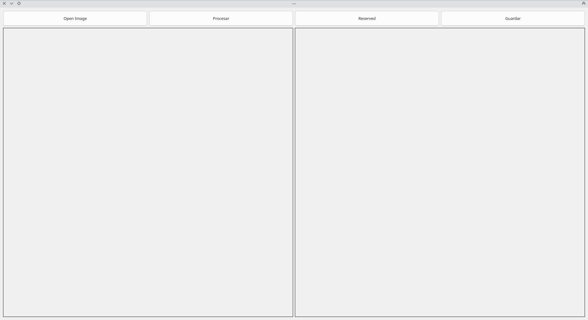
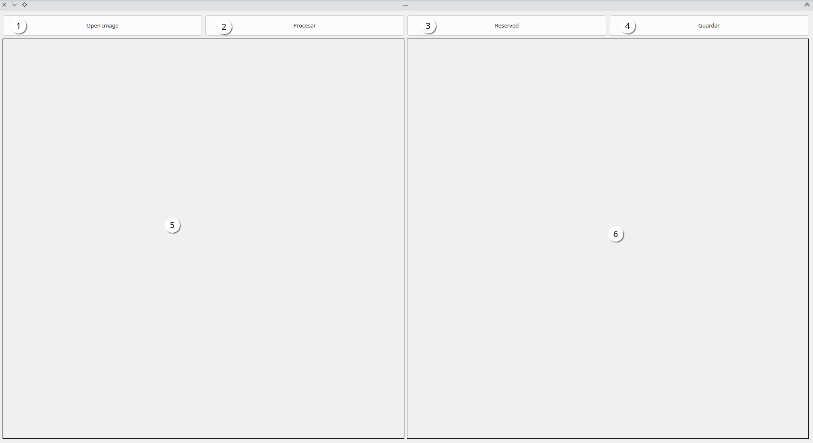
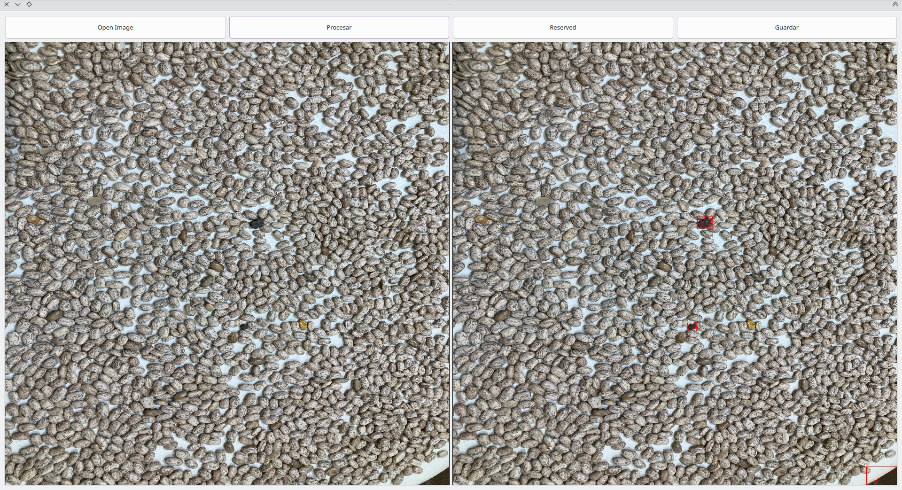
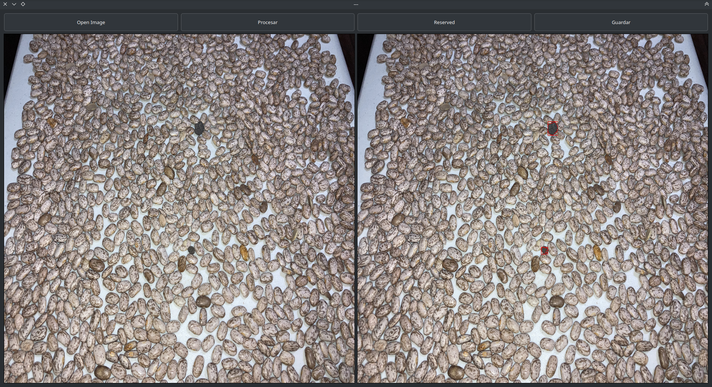
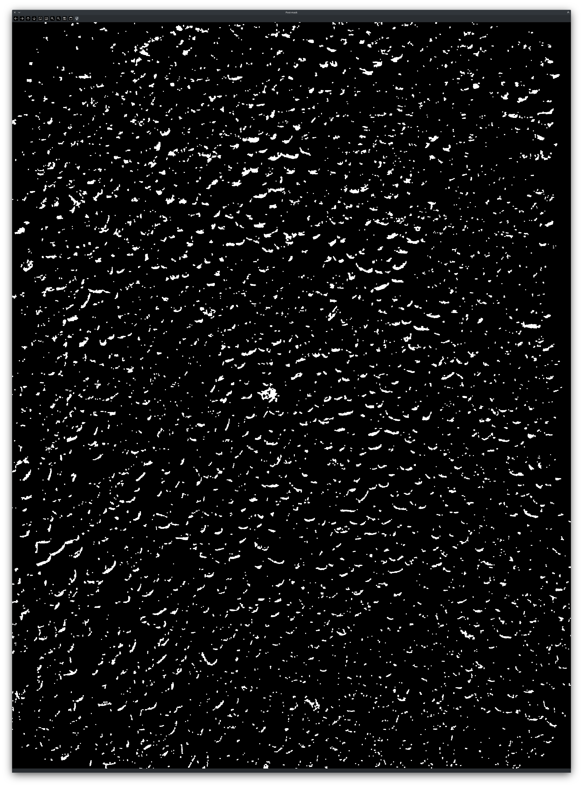
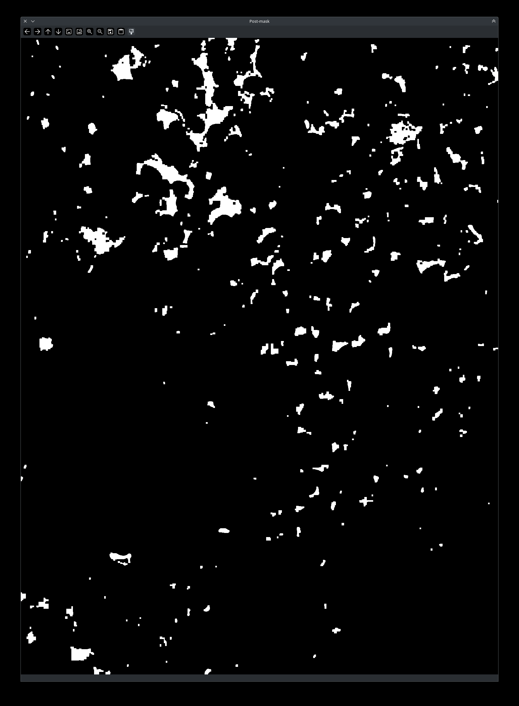

<!-- https://github.com/ricardouriegas/stone-detection-for-beans -->

<!-- # Stone Detection in Beans -->

A computer vision application that identifies potential stones mixed with pinto and black beans using traditional image processing techniques, without relying on neural networks.

## Overview

This application analyzes images of beans to distinguish stones based on differences in color, shape, and geometric properties. It uses OpenCV for image processing and PyQt6 for an interactive desktop interface.

## Application Preview

The application provides an interface for loading images, processing them, inspecting detection results, adding manual annotations, and saving processed images.

*Figure 1: Main application interface.*

*Figure 2: Interface components and image-processing controls.*

## Detection Results

The system uses different segmentation strategies depending on the bean type, accounting for their distinct colors and the appearance of the stones.

### Pinto Beans

For pinto beans, the system uses LAB color-space thresholding combined with morphological operations and contour analysis to identify potential stones.

*Figure 3: Example of stone detection in pinto beans.*

### Black Beans

For black beans, the system uses HSV color-space thresholding and geometric filtering to distinguish lighter-colored stones from the beans.

*Figure 4: Example of stone detection in black beans.*

## Technical Approach

### 1. Image Preprocessing
- Loads and resizes input images for display and processing.
- Selects a processing pipeline based on the dominant image color.
- Converts images into appropriate color spaces for segmentation.

### 2. Color-Based Segmentation
- Applies HSV thresholds to images containing black beans.
- Applies LAB thresholds to images containing pinto beans.
- Generates masks to isolate regions that may correspond to stones.

### 3. Morphological Processing

Uses morphological operations to reduce noise and improve the resulting segmentation masks.

| Pinto Beans | Black Beans |
|:---:|:---:|
|  |  |
| LAB color segmentation | HSV color segmentation |

### 4. Contour Detection and Geometric Filtering

Extracts contours using OpenCV's `findContours` and filters candidate objects using geometric properties.

- **Black beans:** Contour area, convexity ratio, and vertex count.
- **Pinto beans:** Contour area, circularity, convexity ratio, and vertex count.

The remaining contours are highlighted on the original image to visualize potential stone detections.

## Technology Stack

- **Language:** Python
- **Computer Vision:** OpenCV
- **Desktop GUI:** PyQt6
- **Core Techniques:** Color-space thresholding, image segmentation, morphological operations, contour detection, and geometric feature analysis.

## Results and Limitations

The application successfully demonstrated stone detection in controlled images of pinto and black beans. However, testing under different image-capture conditions revealed limitations in detection reliability.

Changes in lighting, background, and image quality can affect segmentation and contour detection. The system's rule-based approach also limits its ability to generalize across the wide variety of stones and beans.

These results highlight the trade-offs between traditional computer vision techniques and robustness under uncontrolled conditions.

## Key Takeaways

- Applied classical computer vision techniques to a food inspection problem.
- Designed separate image-processing pipelines for two visually distinct bean types.
- Combined color segmentation with morphological processing and geometric filtering.
- Developed an end-to-end desktop application for image analysis and result visualization.
- Evaluated the system under varying image conditions and identified opportunities for improving robustness.

---

**Project Type:** Team Project  
**Focus Areas:** Computer Vision · Image Processing · Python · Desktop Application Development


