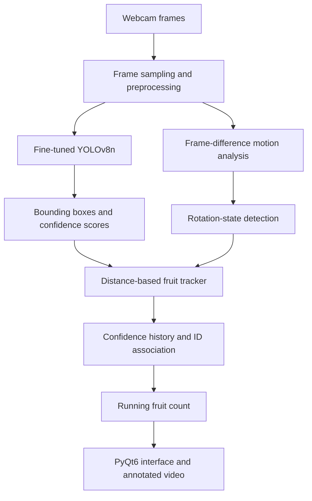

A computer vision project that combines **YOLOv8 object detection**, a live webcam pipeline, and a desktop interface to detect and count small fruits as they move on a rotating platform.

The project explores an end-to-end AI workflow: assembling and augmenting an image dataset, fine-tuning a pretrained object detector, evaluating precision and recall, and integrating model predictions into an interactive Python application.

**Project type:** Academic team project  
**Primary focus:** Computer Vision · Deep Learning · Object Detection · Real-Time Application Development

## Project Links

- **[Model and application repository](https://github.com/ricardouriegas/fruit-detector-model)** — inference interface, training script, and model weights.
- **[Technical documentation](https://github.com/ricardouriegas/fruit-detector-model-documentation)** — experimental report, dataset and training details, evaluation plots, and limitations.

## Overview

Counting small fruits on a moving plant is challenging because objects change position between frames, some fruits have low visual contrast, and leaves or branches can occlude objects. This project explored a practical solution using a pretrained **YOLOv8n** model and a camera feed displayed in a desktop application.

The model was trained to detect one general class, `fruit`. A separate tracking component associates detections across nearby frames and updates a running count. The interface lets the operator start or stop detection, adjust the confidence threshold, select a processing speed, reset the count, and indicate a new rotation of the platform.

The experiment demonstrated real-time detection in controlled conditions, while also revealing important limitations in generalization, low-contrast fruit detection, and counting under occlusion.

## Application Preview


*Figure 1. Desktop interface for the rotating-fruit counting application.*


*Figure 2. Application displaying a live camera feed while detection is running.*

## System Architecture

The application connects an object detection model with a lightweight tracking and counting layer and a PyQt6 user interface.



### Processing pipeline

1. **Capture:** OpenCV reads frames from the computer's default camera (`VideoCapture(0)`).
2. **Frame scheduling:** The application processes frames at a configurable rate to balance responsiveness and computational cost.
3. **Object detection:** The fine-tuned YOLOv8n model predicts bounding boxes and confidence scores for the fruit class.
4. **Detection association:** A custom `FruitTracker` compares detection centers with recently tracked fruit positions and reuses an ID when a nearby match is found.
5. **Confidence smoothing:** The tracker maintains a short confidence history for each tracked ID and uses the average when deciding whether a detection passes the configured threshold.
6. **Counting:** A newly accepted track increments the counter. The interface draws bounding boxes, labels detections, and displays the current count.
7. **Rotation handling:** Frame differencing and contour analysis estimate changes in motion. When a rotation cycle is considered complete, the tracker state is reset for the next pass.

## Dataset and Preparation

The technical report describes a small dataset collected by the project team, with images of small fruits in different environments. The annotation setup contains **one class: fruit**.

| Dataset detail | Documented approach |
|---|---|
| Original images | 38 |
| Images after augmentation | 114 |
| Classes | 1 (`fruit`) |
| Training split | 80% |
| Validation split | 10% |
| Test split | 10% |

The augmentation pipeline was intended to make the model less sensitive to changes in viewing conditions. The documented transformations include:

- Horizontal and vertical flips.
- 90-degree rotations and rotations between -15° and +15°.
- Cropping, up to 20%.
- Horizontal and vertical shear, up to ±10°.
- Hue shifts between -15° and +15°.
- Saturation changes up to ±25%.
- Brightness changes up to ±15% and exposure changes up to ±10%.
- Blur up to 2.5 pixels and noise affecting up to 0.1% of pixels.

The training script uses the Roboflow SDK to retrieve the `little-fruit` project dataset and prepares train, validation, and test folders using an 80/10/10 split. The report's 38-to-114 image count is the documented dataset description; the retrieved dataset version and any generated augmentations should be kept consistent when reproducing the exact experiment.

## Model Selection and Training

### Why YOLOv8n?

The team selected the **YOLOv8n** (nano) object-detection model from Ultralytics because the project needed a model lightweight enough for real-time use and the available training dataset was limited. Rather than training a detector from scratch, the project fine-tuned pretrained weights for the fruit-detection task.

### Documented training configuration

| Parameter | Value |
|---|---|
| Model | Ultralytics YOLOv8n |
| Task | Single-class object detection |
| Training epochs | 40 |
| Image size | 640 × 640 pixels |
| Train / validation / test | 80% / 10% / 10% |
| Other hyperparameters | Defaults, according to the report |

The training script loads `yolov8n.pt`, trains the model, validates it, and attempts to save the best checkpoint. The application currently loads `best.pt` from the project directory for inference. Additional `.pt` files in the repository represent other saved model checkpoints; the report does not establish that all checkpoints have equivalent performance.

## Real-Time Application

The desktop application is implemented in Python with **PyQt6**, **OpenCV**, and **Ultralytics**. It combines the camera feed, inference, visual overlays, tracking state, and operator controls in one window.

### Interface functionality

- **Live camera preview:** Displays frames from the webcam.
- **Detection toggle:** Starts or pauses live inference.
- **Confidence threshold:** A slider adjusts the threshold used by the tracking and display logic. The interface starts at 0.58.
- **Processing speed:** Offers 30, 15, 5, and 2 FPS modes, with frame sampling adjusted for the selected mode.
- **Fruit counter:** Displays the running number of accepted detections.
- **Reset counter:** Resets the count and tracker state.
- **New rotation:** Clears active track state so another rotation can be counted separately.
- **Visual feedback:** Draws bounding boxes, confidence values, and IDs over the video feed.
- **Rotation status:** Shows whether rotation is in progress or has been considered complete.

### Tracking and counting logic

A detector predicts objects independently in each processed frame. Counting every box in every frame would count the same fruit repeatedly, so the project adds a basic tracking component.

The `FruitTracker` implementation:

- Compares detection centers using Euclidean distance.
- Associates a detection with a recently tracked fruit when its center falls within a configured distance threshold (50 pixels by default).
- Assigns an ID when a detection is considered new.
- Stores a rolling history of up to five confidence scores and calculates their average.
- Removes stale entries after they have not been seen for a configured number of frames.
- Increments the running count for accepted new tracks.

The application also estimates rotation state with frame differencing: it compares frames, converts differences to grayscale, applies a threshold and dilation, then sums contour areas as a simple motion score. This is a lightweight heuristic rather than a full object-tracking or physical rotation-sensing system.

## Results and Evaluation

The report evaluates model behavior using precision and recall curves and observations from real-time tests. The most important reported values are threshold-dependent and should not be interpreted as a single overall accuracy score.

| Evaluation observation | Reported result | Interpretation |
|---|---:|---|
| Maximum precision | 1.00 at confidence threshold 0.583 | At this point on the precision-confidence curve, accepted predictions were correct in the evaluated data. |
| Recall at confidence threshold 0 | Approximately 56% | With essentially no confidence filtering, the model detected a little over half of the fruits present in the evaluation described by the report. |
| Recommended operating range from the report | Confidence threshold above 0.5 | Higher thresholds improved precision but reduced recall. |

These figures describe particular points on the reported curves, not a guarantee of perfect precision in real-world deployment. The report also notes that practical results varied by fruit color, position, lighting, and occlusion. It does not provide enough information to claim a universal accuracy rate or production-level reliability.

### Detection examples


*Figure 3. Example of a detection result.*


*Figure 4. Additional detection example.*


*Figure 5. Additional detection example.*


*Figure 6. Additional detection example.*

### Evaluation curves

The project report includes the following evaluation plots:

| Precision vs. confidence | Recall vs. confidence |
|---|---|
|  |  |


*Figure 7. Precision-recall curve from the project report.*

### Test on a strawberry plant

The report also documents a test on a real strawberry plant. It highlights the difference between detecting a fruit in an individual frame and counting it reliably as the plant rotates.


*Figure 8. Real-world detection example.*


*Figure 9. Example illustrating a repeated count when the fruit is occluded and later appears again.*

## Limitations

The experiment exposed several limitations that are important for interpreting the results accurately.

### Limited dataset diversity

The dataset was small. A model trained on a limited number of images may not generalize reliably across different fruit varieties, backgrounds, cameras, scales, and lighting conditions.

### Bias toward visually salient fruit

The report found that red and orange fruits were easier to detect than less saturated fruits, particularly green fruit. The single-class dataset also means the system detects the general `fruit` class rather than classifying fruit species.

### Occlusion and repeated counting

When the plant rotates, a fruit may disappear behind leaves or branches and later re-enter the camera view. Since the tracker primarily associates detections using image-space distance and recent positions, it may treat the returning fruit as a new object and count it again. The current approach is not a robust multi-object tracking solution for prolonged occlusion.

### Sensitivity to position and lighting

Fruit in unusual positions or less favorable lighting conditions was harder to detect. High confidence thresholds reduce false positives but can miss more real fruits, so the practical setup requires a trade-off between precision and recall.

### Hardware and reproducibility considerations

The user interface attempts to select Apple Silicon MPS, CUDA, or CPU depending on availability. The training script, however, explicitly specifies `device="mps"`; reproducing training on a machine without Apple Silicon requires adjusting that setting. The script also randomizes the image split without setting a random seed, so the exact split may differ between runs.

## Potential Improvements

The project suggests several paths for improving reliability and making the experiment easier to reproduce:

1. **Expand and balance the dataset.** Include more fruits, especially green and low-saturation fruit, along with varied backgrounds, camera distances, and lighting.
2. **Improve experimental reproducibility.** Version the dataset, record package versions and all training parameters, set random seeds, and retain the exact train/validation/test split.
3. **Evaluate beyond a single threshold.** Report mAP, precision, recall, and per-condition results on a held-out dataset, alongside threshold-specific results.
4. **Use stronger tracking.** Explore a dedicated multi-object tracking algorithm and more persistent object association to reduce duplicate counts through occlusion.
5. **Improve rotation handling.** Validate the frame-difference heuristic across different movement speeds and lighting conditions, or use an explicit rotation sensor if the hardware allows it.
6. **Separate detection from counting evaluation.** Measure per-frame detection quality separately from complete-rotation counting error, since reliable detections do not automatically guarantee a correct final count.
7. **Harden the application.** Add dependency pinning, configurable camera selection, clearer model-loading errors, and a secure configuration for dataset credentials.

## Technology Stack

| Area | Tools and techniques |
|---|---|
| Language | Python |
| Object detection | Ultralytics YOLOv8n |
| Computer vision | OpenCV |
| Deep learning runtime | PyTorch |
| Desktop interface | PyQt6 |
| Data preparation | Roboflow SDK, YAML, Python file operations |
| Augmentation | Flips, rotations, crops, shear, color adjustments, blur, and noise |
| Tracking | Distance-based association and rolling confidence history |
| Evaluation | Precision-confidence, recall-confidence, and precision-recall curves |

## Running the Application

The inference interface expects the trained `best.pt` file in the project root and uses the computer's default webcam (`0`). A compatible Python and PyTorch installation is required; the exact PyTorch build should match the operating system and available acceleration hardware.

```bash
git clone https://github.com/ricardouriegas/fruit-detector-model.git
cd fruit-detector-model
python -m venv .venv
source .venv/bin/activate
python -m pip install --upgrade pip
python -m pip install ultralytics opencv-python PyQt6 numpy torch
python UI.py
```

On Windows, activate the environment with `.venv\Scripts\activate`. If the interface cannot open the camera or load the model, verify the webcam index, that `best.pt` exists in the project root, and that PyTorch/Ultralytics are installed correctly for the machine.

### Training script

The repository's `main.py` retrieves a dataset through Roboflow, prepares splits, trains YOLOv8n for 40 epochs, and runs validation. Before running it, configure a valid Roboflow API key through an environment variable rather than embedding a secret in source code. The checked-in training script should be updated to read that variable (for example, `os.environ["ROBOFLOW_API_KEY"]`) and should select a training device compatible with the host machine.

## Key Takeaways

- Built an end-to-end computer vision workflow, spanning dataset preparation, transfer learning, evaluation, and live inference.
- Applied a pretrained YOLOv8n detector to a single-class fruit-detection problem.
- Integrated model inference into a desktop application with interactive controls and annotated camera output.
- Implemented a lightweight tracking and counting layer rather than counting every per-frame detection independently.
- Evaluated model behavior with precision and recall curves and identified concrete failure modes in a real-world setting.
- Learned that detection quality, object tracking, and reliable counting are distinct engineering problems that must be evaluated separately.

## References

- [Model repository](https://github.com/ricardouriegas/fruit-detector-model)
- [Project report and documentation](https://github.com/ricardouriegas/fruit-detector-model-documentation)
- [Ultralytics YOLO documentation](https://docs.ultralytics.com/)
- [PyQt6 documentation](https://www.riverbankcomputing.com/software/pyqt/)
- [OpenCV documentation](https://docs.opencv.org/)

---

*This project is an academic prototype and should not be interpreted as a production-ready fruit-counting system. The results and limitations above are based on the project report and the repository implementation.*
